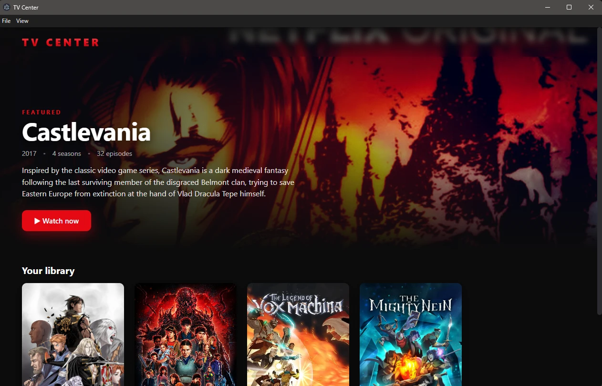
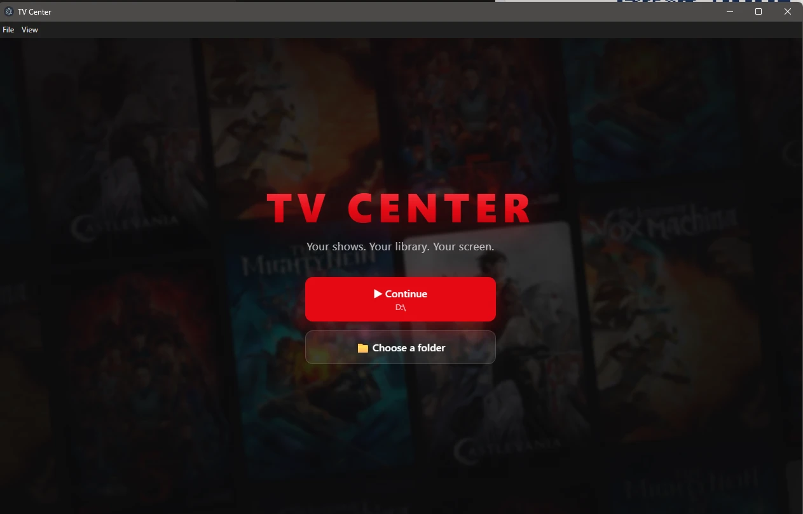
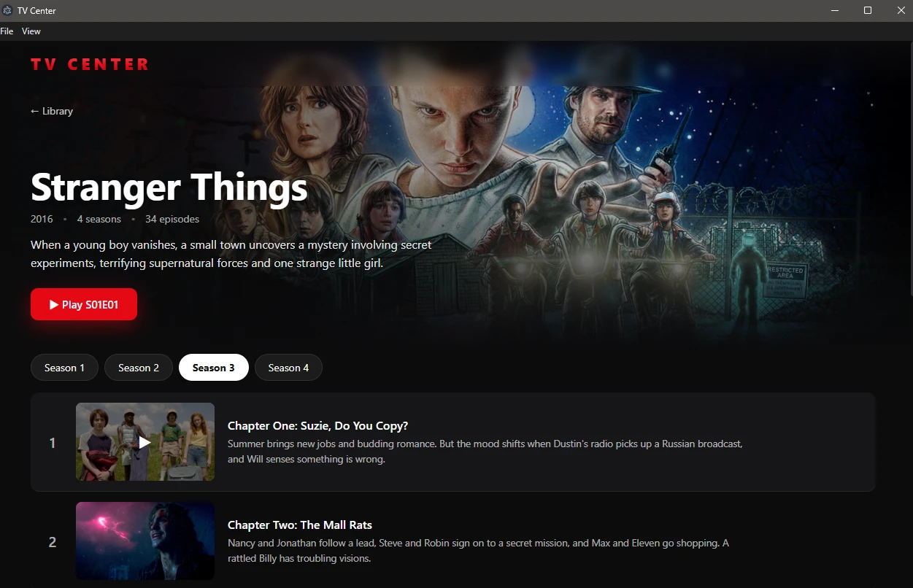

# TV Center

A self-hosted, Netflix-style library for your own downloaded TV shows.
It's a single desktop app — no Node, Python, or setup required to use it.

## Screenshots

<p align="center">
  
  <br />
  <em>Library — a featured show up top and your whole collection below.</em>
</p>

<table>
  <tr>
    <td width="50%" align="center">
      
      <br />
      <em>Welcome — continue with your saved folder or pick another.</em>
    </td>
    <td width="50%" align="center">
      
      <br />
      <em>Series — browse episodes season by season.</em>
    </td>
  </tr>
</table>

## Using it

1. Download `TV Center Setup <version>.exe` from the
   [Releases page](https://github.com/ofmgdev/tv-center/releases) and install it.
2. Launch **TV Center**. On first run it asks you to choose the folder that
   holds your TV show files.
3. It scans that folder, fetches posters/descriptions/episode titles
   automatically (via the free [TVmaze](https://www.tvmaze.com/api) API — no
   account needed), and opens your library.

**File menu:**
- **Change Media Folder…** — switch to a different folder and rescan
- **Rescan Current Folder** — pick up newly added episodes

Your folder choice and the library database live in your user profile
(`%APPDATA%\tv-center`), not in the install directory.

### File naming

Standard names work out of the box (`Show Name S01E02 ...mkv`). For names the
parser can't read (e.g. Hebrew episode naming), use a folder layout of
`<Show Name>/<... season N ...>/<episode file>` and the season/episode are
taken from the folder + filename.

> Note: `.mkv` and `.avi` files may not play if your system lacks the codec —
> `.mp4` is the safe bet for in-app playback.

## Project layout

- **`desktop/`** — the Electron app. Contains everything:
  - `lib/db.js` — SQLite schema/access (`better-sqlite3`)
  - `lib/api.js` — Express REST API + range-request video streaming, and it
    serves the built React UI
  - `lib/scanner.js` — walks the media folder, parses filenames
    (`parse-torrent-title` + a folder-based fallback), fetches metadata
  - `lib/tvmaze.js` — metadata/poster lookup
  - `main.js` — Electron main process: folder picker, wiring, menu
- **`frontend/`** — React + Vite source for the UI. `npm run build` outputs
  into `desktop/renderer/`, which the app serves.

## Building from source

```bash
cd desktop
npm install
npm start          # build the UI + run the app
npm run dist       # produce the Windows installer in desktop/release/
```

`npm install` pulls a prebuilt `better-sqlite3` binary for Electron — no
compiler needed.
